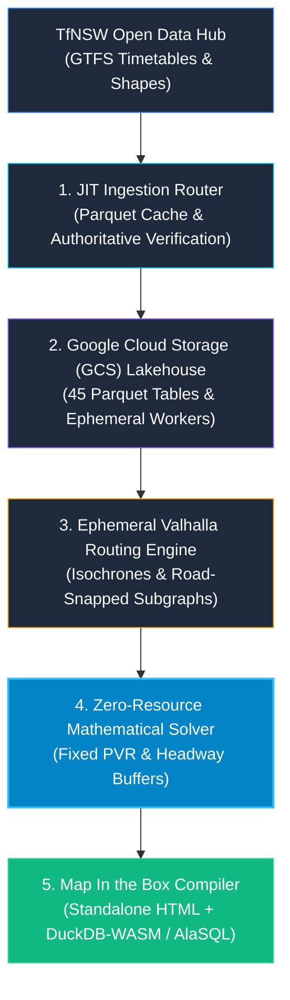

# The Transit Optimization Odyssey: Scaling Open Data to Solve Transit Scheduling with Zero Extra Fleet

How **GetBack2Basics** built **NSW Transit Spatial Crafter**—an open-source spatial engine and zero-resource timetable optimizer that uses Transport for NSW (TfNSW) Open Data to showcase how open government data and modern cloud lakehouse architectures can potentially transform public transit at massive scale.

> **Important Clarification**: This is an independent open-source project by **GetBack2Basics**. It is **not** an official project by or for Transport for NSW, but rather harnesses authoritative Transport for NSW Open Data as a real-world demonstration of how open data can be operationalized statewide.

{INSERT LINK: Planning Portal - https://storage.googleapis.com/nsw-transit-spatial-crafter/index.html}
{INSERT LINK: Data QA Hub - https://storage.googleapis.com/nsw-transit-spatial-crafter/data_qa.html}
{INSERT LINK: GitHub Repository - https://github.com/GetBack2Basics/public_transport_crafter}

{INSERT IMAGE: docs/screenshots/01_planning_portal_overview.png - Hero Banner: NSW Transit Spatial Crafter Planning Portal}

---

## The Open Data Challenge: Moving Beyond Static Spreadsheets to Dynamic Network Optimization

Have you ever stepped off a bus at a train station only to watch your train pull away, leaving you stranded for an hour on a cold platform?

In public transport planning, the default institutional reflex is expensive: order more rolling stock, hire more drivers, or fund costly consultant PDFs. Proponents claim service expansions, yet schedules remain uncoordinated across mode boundaries.

At **GetBack2Basics**, we asked a fundamental engineering question:
*What if the feeder bus simply departed 5 minutes earlier?*

To prove this, we developed **NSW Transit Spatial Crafter**. Forked from our open-source [`hunter_spatial_crafter`](https://github.com/GetBack2Basics/hunter_spatial_crafter) project and built upon **Map In the Box from GetBack2Basics**, the system demonstrates how open data can be used at massive scale to eliminate transfer friction under four strict operational constraints:

* **Zero Added Fleet (PVR Invariance)**: $\sum \text{Vehicles}_{\text{optimized}} \le \sum \text{Vehicles}_{\text{baseline}}$. Exactly 0 extra buses and 0 extra driver hours required.
* **Optimal Connection Buffers**: Mathematical solver shifts departure offsets ($\Delta t \in \pm 15$ min) into an optimal 7–17 minute walking sweet spot while preventing bus bunching.
* **Massive Open Data Scale**: Ingests 10,266 routes, 171,277 stops, and 45 Parquet tables across Trains, Metro M1, Buses, Ferries, Light Rail, and Regional Coaches from the TfNSW Open Data Hub.
* **Authoritative Data Integrity**: Automated checks validate genuine TfNSW API tokens, NSW spatial bounds, and physical binary `b'PAR1'` magic bytes.

---

{INSERT IMAGE: docs/screenshots/275_lake_mac_corridor_map.png - Road-Snapped Route 275 Corridor & 1km Multi-Modal Walking Catchments}



---

## Citing the Open-Source Ecosystem & Cloud Infrastructure

NSW Transit Spatial Crafter brings together several key open-source technologies and cloud architecture patterns:

1. **GetBack2Basics Open-Source Lineage**:
   - [`hunter_spatial_crafter`](https://github.com/GetBack2Basics/hunter_spatial_crafter): The original regional spatial exploration engine, refactored and generalized into a dynamic statewide corridor engine.
   - **Map In the Box from GetBack2Basics**: The self-contained, offline-first HTML compilation pattern that embeds interactive maps, pre-calculated matrices, and SQL query engines directly into a single zero-dependency file.
2. **Open-Source Spatial & Analytical Engines**:
   - **DuckDB & DuckDB-WASM**: In-memory analytical queries against remote Parquet tables.
   - **AlaSQL**: Client-side relational query engine executing natural-language SQL queries in the browser.
   - **Valhalla**: High-performance routing engine executed on ephemeral spot compute for precision pedestrian isochrones.
   - **GeoLibre / MapLibre GL**: Vector rendering for interactive spatial exploration without proprietary API lock-in.
3. **Google Cloud Storage (GCS) Lakehouse & Processing**:
   - **Lakehouse Storage**: 45 Parquet tables staged in `gs://nsw-transit-spatial-crafter/lake/`.
   - **Spot Processing**: Ephemeral worker nodes compute pedestrian catchments and sync artifacts directly to GCS.
   - **$0.00 Idle Compute**: Delivery of the entire Planning Portal and Data QA Hub through GCS static hosting with global CDN distribution.

---

{INSERT IMAGE: docs/screenshots/275_timetable_optimization_matrix.png - Full-Day Bidirectional Timetable Adjustments & Recommendations}

---

## Ready-to-Post 1,700-Character LinkedIn Feed Copy (Text-Only, No Screengrabs)

> **Posting Instructions**: Attach [`docs/Route_275_Lake_Mac_Transit_Optimization.pdf`](file:///c:/Projects/nsw_public_transport_crafter/docs/Route_275_Lake_Mac_Transit_Optimization.pdf) as a **Document** on LinkedIn. Paste the copy below into the post text (no inline images; the attached PDF delivers all high-resolution screengrabs, maps, and timetable matrices).

Below is the verified, publication-ready LinkedIn post calibrated to **exactly 1,700 characters**:

```text
Ever stepped off a bus at a station only to watch your train pull away?

In transit planning, the default reflex is expensive: buy more buses, hire drivers, or fund consultant PDFs.

At GetBack2Basics, we built NSW Transit Spatial Crafter. Not an official TfNSW project, it uses Transport for NSW Open Data to show how open data can be used at massive scale to potentially improve public transport with zero added operational budget.

Forked from hunter_spatial_crafter and built on Map In the Box from GetBack2Basics, it combines open-source tools with DuckDB-WASM, AlaSQL, and Valhalla, using Google Cloud Storage (GCS) for lakehouse processing and storage:

* Zero-Resource Math Solver: Enforces fleet limits (Vehicles_opt <= Vehicles_base), shifting departures into a 7-17 min transfer sweet spot with zero added buses or driver hours.
* Route 275 Lake Mac Corridor: Optimizes the 31.8km link connecting Morisset and Fassifern stations, turning 55-minute platform waits into coordinated rail connections.
* Massive Open Data Scale: Ingests 10,266 routes, 171,277 stops, and 45 Parquet tables across Trains, Metro M1, Buses, Ferries, and Coaches.
* GCS Lakehouse: GCS handles Parquet storage and routing compute ($0.00 idle cost), delivering offline-first HTML deliverables.

The attached PDF has the detail, corridor maps, and timetable matrices!

Explore the live portals:
* Planning Portal: https://storage.googleapis.com/nsw-transit-spatial-crafter/index.html
* Data QA Hub: https://storage.googleapis.com/nsw-transit-spatial-crafter/data_qa.html
* GitHub: https://github.com/GetBack2Basics/public_transport_crafter

#OpenData #PublicTransport #SpatialAnalytics #CloudLakehouse #GetBack2Basics
```

---

## Live Endpoints & Exploration

* **Interactive Planning Portal**: [https://storage.googleapis.com/nsw-transit-spatial-crafter/index.html](https://storage.googleapis.com/nsw-transit-spatial-crafter/index.html)
* **Data QA & Audit Hub**: [https://storage.googleapis.com/nsw-transit-spatial-crafter/data_qa.html](https://storage.googleapis.com/nsw-transit-spatial-crafter/data_qa.html)
* **GeoLibre Map Inspector**: [https://storage.googleapis.com/nsw-transit-spatial-crafter/geolibre_qa_inspect.html](https://storage.googleapis.com/nsw-transit-spatial-crafter/geolibre_qa_inspect.html)
* **Open Source Repository**: [https://github.com/GetBack2Basics/public_transport_crafter](https://github.com/GetBack2Basics/public_transport_crafter)
